# prism-statplot

A Claude skill for publication-style group comparison plots. Install it once,
then ask in plain words: describe your experiment, name a colour style, and
Claude runs the right test and draws the figure.

You write no plotting code. You say what you measured, how the experiment was
designed, and which look you want. The skill holds the rules Claude follows for
the statistics, the figure and the colours.

<p align="center">
  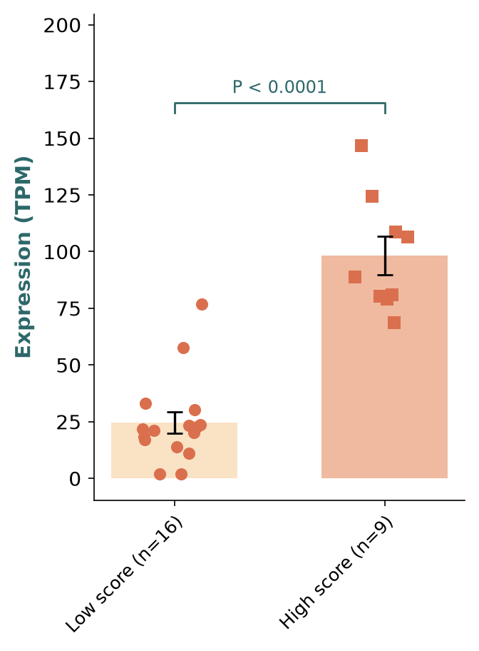
  
  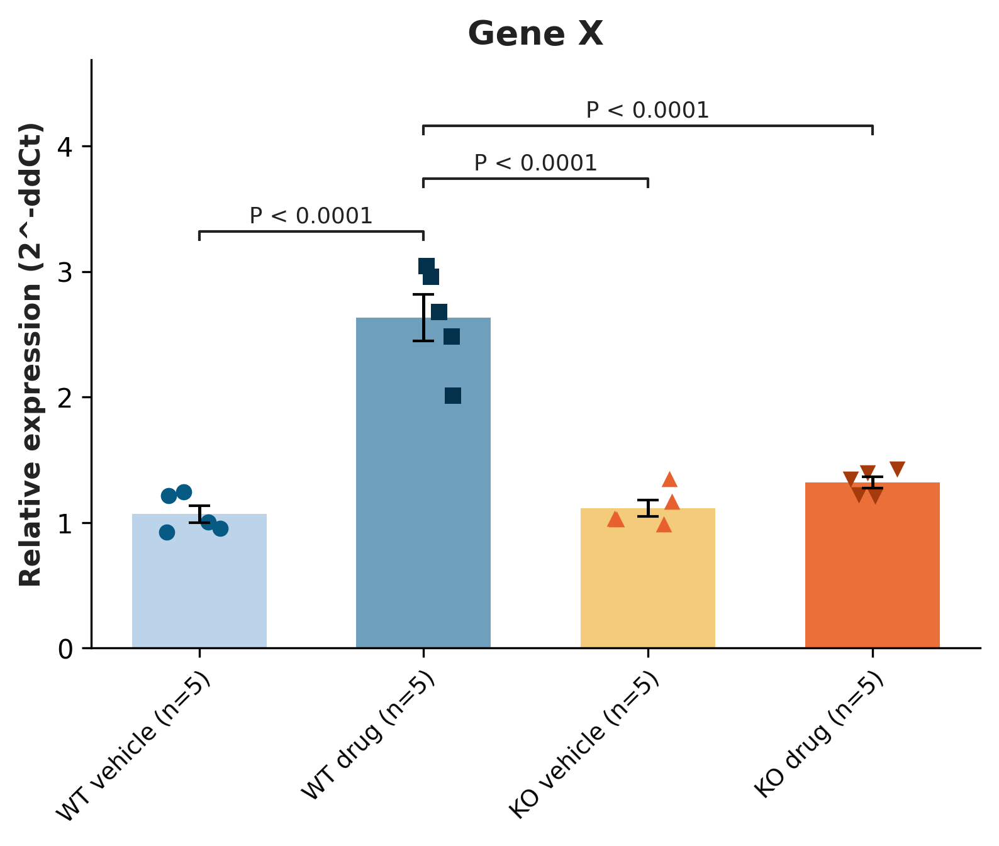
</p>

<details>
<summary><b>中文简介</b></summary>

<br>

prism-statplot 是一个 Claude 技能，用来画 GraphPad Prism 风格的组间比较图。装好之后不用写代码，用自然语言说就可以。

- **安装一次。** 在 Claude 应用里上传技能，或者在 Claude Code 里用一条命令克隆到技能目录。见[安装](#install-the-skill)。
- **用自然语言提要求。** 说明测的是什么（RNA、蛋白、qPCR 等）、实验怎么设计（几组、是否配对、和谁比），Claude 会选对检验方法、画图，并给出一句可以写进 Methods 的话。
- **用一句话选配色风格。** 共七套：`bright`、`massier`、`npg`、`stallion`、`okabe`、`gastrulation`、`amp`。可以直接说名字，比如"用 massier 风格"，也可以描述想要的效果，比如"色盲友好""柔和一点""Nature 风格"。说"换成 stallion"就会只换颜色重画。见[选择配色风格](#choose-a-colour-style)。
- **单细胞建议做两层注释。** 先粗注释（大类），再细注释（亚型）。每个大类一个色系，同一大类的亚型用这个色系里由浅到深的颜色。见[单细胞数据](#single-cell-data-two-levels-of-annotation-two-levels-of-colour)。

</details>

## What the skill does

| You say | Claude does |
|---|---|
| What you measured and how the experiment was designed | Chooses the statistical test and the matching correction for multiple comparisons |
| Which colour style you want, by name or by description | Applies one of seven colour themes to every figure |
| Nothing more | Draws the figure in a fixed layout and writes the sentence for your Methods section |

## Contents

- [Install the skill](#install-the-skill)
- [Use it: just ask](#use-it-just-ask)
- [Choose a colour style](#choose-a-colour-style)
- [Single-cell data: two levels of annotation, two levels of colour](#single-cell-data-two-levels-of-annotation-two-levels-of-colour)
- [What Claude decides for you](#what-claude-decides-for-you)
- [Examples](#examples)
- [When not to use it](#when-not-to-use-it)
- [For Python users](#for-python-users)
- [Where the colours come from](#where-the-colours-come-from)

## Install the skill

A skill is a folder with a `SKILL.md` file. This one also carries `kernel.py`,
the code Claude runs. Pick the route that matches where you use Claude.

### In the Claude app

1. On this page, choose **Code → Download ZIP** and unzip it.
2. Rename the folder from `prism-statplot-main` to `prism-statplot`. The folder
   name must match the name of the skill. You can delete the `examples` folder
   to make the upload smaller.
3. Zip the `prism-statplot` folder again.
4. In Claude, open **Customize → Skills**, click **+**, choose **Create
   skill**, then **Upload a skill**, and select the ZIP file.

> [!NOTE]
> Skills need code execution and file creation. Turn this on under
> **Settings → Capabilities** if the upload option is missing.

### In Claude Code

One command puts the skill where Claude Code looks for personal skills:

```bash
git clone https://github.com/alexpengyl1/prism-statplot.git ~/.claude/skills/prism-statplot
```

To get a newer version later:

```bash
git -C ~/.claude/skills/prism-statplot pull
```

### In Claude Science

Import this repository as a skill. The functions in `kernel.py` load
automatically with it.

### Check that it works

Ask Claude this in a new conversation:

> Which colour styles does prism-statplot have?

Claude should list seven styles by name.

## Use it: just ask

Give Claude your numbers, in a file or pasted into the chat, and describe the
experiment in a sentence or two.

> These are qPCR fold changes for gene X in control, IR and IR + drug, four
> mice per group. Compare each treatment with the control and plot it in the
> massier style.

Claude replies with four things:

- **The figure**, saved as PDF and PNG.
- **The style it used**, by name, so you can ask for another.
- **A methods sentence** that says exactly which test was run, for example:
  "Differences were assessed by one-way ANOVA followed by Dunnett's multiple
  comparisons test on log2-transformed values (two-sided, alpha = 0.05). Bars
  show mean +/- SEM; each point is one biological replicate (n = 4/4/4)."
- **Warnings**, when something limits what the P values can tell you, such as
  groups that are too small for the test.

### What to tell Claude

The more of these you state, the fewer assumptions Claude has to make.

| Tell Claude | Why it matters | For example |
|---|---|---|
| What was measured | Sets the scale for the test and whether bars start at zero | "protein intensities, already log2" · "qPCR 的 2^-ΔΔCt 值" |
| What one value is | One point must be one biological replicate | "one value per mouse" · "每个点是一只小鼠" |
| Whether groups are paired | Paired designs need paired tests | "the same patients before and after" · "同一批病人治疗前后" |
| Which comparisons you want | Every pair, or each group against a control | "compare each dose with vehicle" · "每组都和对照比" |
| Which colour style | Sets the look of every figure | "use the okabe style" · "用 massier 风格" |

> [!IMPORTANT]
> One point is one biological replicate: one animal, one patient, one
> independent culture. For single-cell data, ask Claude to reduce each sample
> to one value (pseudobulk) before testing. Thousands of cells from three mice
> are still three replicates.

## Choose a colour style

A style is a complete colour scheme. It colours every kind of figure and the
accent of brackets, P values and titles. There are seven. You choose one by
name or by describing the look you want.

| Say | 也可以这样说 | You get |
|---|---|---|
| "Use the massier style." | "用 massier 风格。" | That style, for this figure and every later one |
| "Make it colour-blind safe." | "要色盲友好的配色。" | `okabe` |
| "Something softer and earthier." | "柔和一点，偏大地色。" | `gastrulation` |
| "Bold colours, it's for a poster." | "颜色鲜艳一点，做海报用。" | `stallion` |
| "Nature style." | "换成 Nature 风格的配色。" | `npg` |
| "Which styles are there?" | "有哪些配色可以选？" | The list of seven, and an offer to draw your figure in two or three of them |

If you name no style, Claude uses `bright` and tells you the others exist.

### The seven styles

Each strip shows the same five designs: two groups, a control with three
treatments, six groups, 2 × 2 families and 3 × 2 families.

#### `bright` (the default)

Pale pastel bars with saturated points and a teal accent. The first two groups
are the two-colour reference style: peach and salmon bars with coral points.

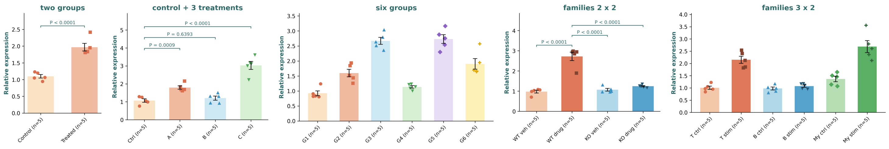

Say: "the default style", "pastel" · "原来的风格""淡彩"

#### `massier`

Blue, soft yellow to orange, green, purple, brown and wine red. From Massier et
al. 2023, *Nat Commun* 14, 1438, the human white adipose tissue atlas.

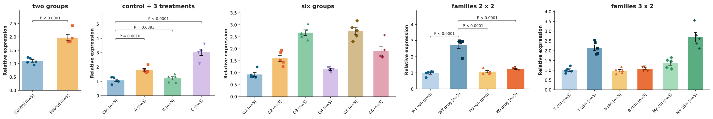

Say: "the massier style", "like the adipose atlas paper" · "massier 风格""文章那种配色"

#### `npg`

Red, navy, teal, brown, cyan and salmon. The ggsci "npg" palette, modelled on
figures in Nature Publishing Group journals.

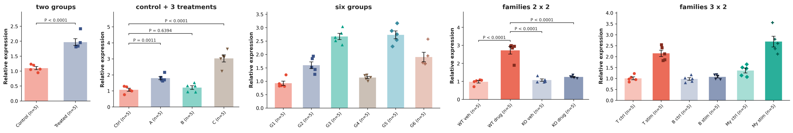

Say: "Nature style", "NPG" · "Nature 风格"

#### `stallion`

Bold red, navy, green, purple and orange. The ArchR "stallion" palette (Granja
et al. 2021, *Nat Genet* 53, 403), used for the cell types in Kuppe et al. 2022,
*Nature* 608, 766.

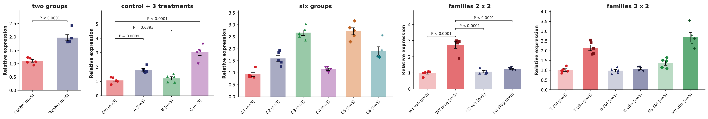

Say: "bold", "vivid", "for slides" · "鲜艳""对比强"

#### `okabe`

Blue, vermilion, green and pink. These are Okabe-Ito colours, as used in Wu et
al. 2021, *Nat Genet* 53, 1334, the breast cancer atlas. The safest choice for
readers with colour blindness.

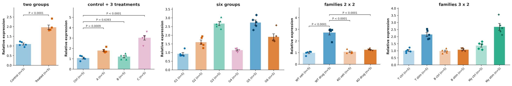

Say: "colour-blind safe" · "色盲友好"

#### `gastrulation`

Soft and earthy: blue, red-orange, teal, lilac, rose and green. From Pijuan-Sala
et al. 2019, *Nature* 566, 490, the mouse gastrulation atlas.

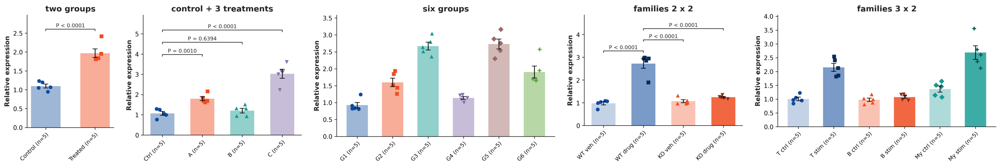

Say: "soft", "earthy", "quiet" · "柔和""大地色""素一点"

The bars are the softest of the seven. The points stay saturated in every
style, so that they remain visible on their bar.

#### `amp`

One light-to-dark ramp per lineage: blue, red, teal, magenta and brown. From
Zhang et al. 2019, *Nat Immunol* 20, 928, rheumatoid arthritis synovium.

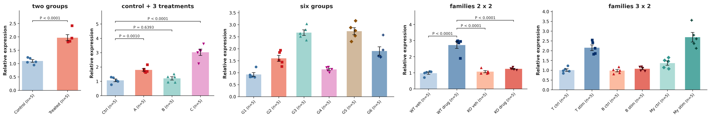

Say: "one ramp per lineage", "the AMP colours" · "每个谱系一条色带"

### Which style for which purpose

| If you want | Ask for |
|---|---|
| The original pastel look, or two groups in peach and coral | `bright` |
| Figures that sit next to a single-cell atlas and share its colours | `massier`, `stallion`, `gastrulation` or `amp` |
| The familiar look of *Nature*-family figures | `npg` |
| A figure that readers with colour blindness can read | `okabe`, then `massier` |
| Strong colours for a slide or a poster | `stallion` |
| A quiet figure with many panels | `gastrulation` |

### Switching and keeping a style

| Say | 也可以这样说 | What happens |
|---|---|---|
| "Switch to stallion." | "换成 stallion。" | The same figure is redrawn in the new style. The data, the test and the group order stay as they were |
| "Show me this in massier, npg and okabe." | "用 massier、npg、okabe 各画一版给我看。" | Three versions side by side, so you can choose |
| "Use npg for this one figure only." | "只有这张图用 npg。" | One figure in that style. Your chosen style stays in place for the rest |
| "Use my own colours: WT #4C72B0, KO #C44E52." | "用我自己的颜色：WT 是 #4C72B0，KO 是 #C44E52。" | Your colours for the points, with a lightened bar |

A style stays chosen for the rest of the conversation. To make one your default
across conversations, add a line to your project instructions, for example:
"Use the massier style for prism-statplot figures."

### Colour that follows the design

Within a style, the colours also show how the experiment is built. Say what the
groups are and Claude picks the matching scheme.

| Your design | Say | 也可以这样说 | Colours |
|---|---|---|---|
| A control and treatments | "Ctrl is the control." | "Ctrl 是对照组。" | The control takes the first hue |
| A dose or time series | "The groups are increasing doses." | "这几组是递增的剂量。" | A warm ramp from yellow to deep red |
| Two factors | "It's genotype × treatment: colour by genotype." | "这是基因型 × 处理，按基因型分色。" | One hue per genotype. Treatments step from light to dark |
| Groups coloured elsewhere | "Use the same colours as my UMAP." | "和我 UMAP 上的颜色保持一致。" | Your existing colours |

| Genotype × treatment | Genotype × dose |
|---|---|
|  | 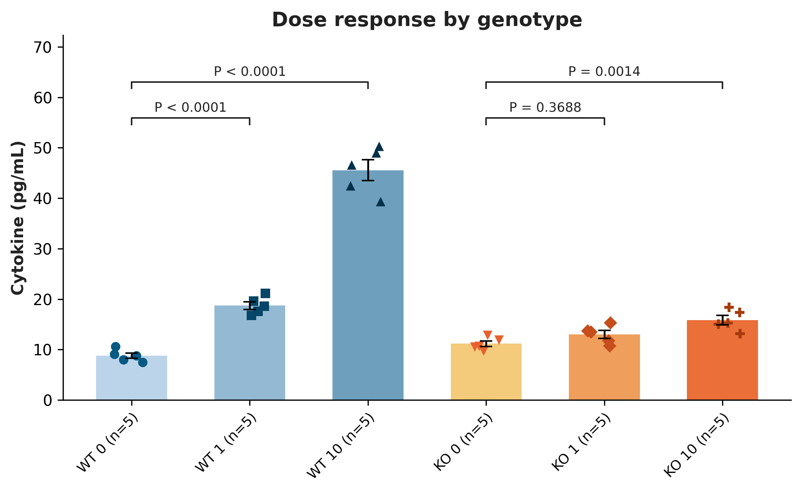 |

Three things happen without your asking:

- **Points stand out from their own bar.** The bar is a light shade and the
  points are a dark shade of the same hue.
- **Every group has its own marker shape.** Colour is never the only cue, which
  matters in greyscale and for readers with colour blindness.
- **No two groups look the same.** When a figure has more groups than the style
  has hues, the hues start a second round with a deeper bar and darker points.

<details>
<summary><b>Measured contrast of each style</b></summary>

<br>

Colour difference in OKLab (ΔE × 100), lowest value over all pairs of groups,
taking the better of bar and point. The second number is the same under
simulated red-green colour blindness. Around 8 or more is easy to tell apart.

| Style | Point vs its bar | 4 groups | 2 × 2 families | 6 groups |
|---|---|---|---|---|
| `bright` | 18.6 | 10.1 / 2.8 | 19.6 / 16.5 | 10.1 / 2.8 |
| `massier` | 18.5 | 20.9 / 7.7 | 18.0 / 16.8 | 16.6 / 7.5 |
| `npg` | 19.0 | 15.5 / 4.8 | 18.0 / 13.8 | 8.3 / 4.8 |
| `stallion` | 23.4 | 19.5 / 4.9 | 18.4 / 12.1 | 11.0 / 4.9 |
| `okabe` | 18.3 | 16.4 / 7.6 | 18.8 / 17.0 | 16.4 / 7.6 |
| `gastrulation` | 19.7 | 16.7 / 6.1 | 18.3 / 17.3 | 11.4 / 3.1 |
| `amp` | 22.1 | 13.1 / 6.0 | 20.7 / 16.7 | 13.1 / 4.7 |

The low colour-blind value of `bright` comes from its first two groups, which
share the coral point colour by design.

</details>

## Single-cell data: two levels of annotation, two levels of colour

A single-cell dataset often has 20 or more cell types. No set of 20 unrelated
colours is easy to read: the eye cannot hold that many categories, and several
pairs always end up looking alike.

The fix starts with the annotation, not with the palette. **Annotate twice:
first coarse, then fine.** Then the colour follows the same two levels: one hue
for each coarse lineage, and shades of that hue for the fine cell types inside
it.

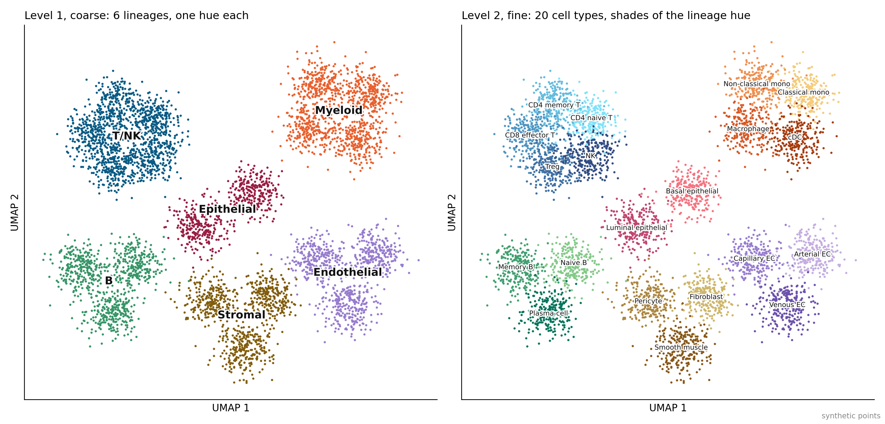

A reader of the right-hand panel sees the lineage first, from the hue, and the
subtype second, from the shade. All blue cells are T or NK cells before any
label is read.

### The workflow

**Step 1. Coarse annotation.** Cluster at low resolution and name the major
lineages from canonical markers: T/NK, myeloid, B, endothelial, stromal,
epithelial. Aim for five to seven lineages. This level is robust and rarely
changes later.

**Step 2. Fine annotation.** Take one lineage at a time, re-cluster it on its
own, and name the subtypes. Every fine cell type then belongs to exactly one
lineage. Keep both labels as two columns of your data.

**Step 3. Ask for the colours.** Tell Claude which column is which:

> My AnnData has `cell_type_coarse` and `cell_type_fine`. Colour the UMAP at
> both levels in the massier style, one hue per coarse lineage.

> 我的 adata 里有 `cell_type_coarse` 和 `cell_type_fine` 两列。用 massier
> 风格给两层 UMAP 配色，每个大类一个色系。

**Step 4. Keep the colours for every later figure.**

> Use the same cell-type colours for the composition bar chart and the violin
> plots.

> 后面的组成比例图和小提琴图也用同一套细胞类型颜色。

### Which level for which figure

| Figure | Level | Why |
|---|---|---|
| Overview UMAP of the whole dataset | Coarse | Six colours read at a glance |
| UMAP of one re-clustered lineage | Fine | The shades of one hue are all that is on the plot |
| Full UMAP with every cell type | Fine | The hue still shows the lineage |
| Cell-type composition per sample | Coarse, or fine within one lineage | Stacked bars with 20 colours are hard to read |
| Marker dot plot or heatmap annotation bar | Both | A coarse bar next to a fine bar shows the nesting |

### What to expect

- **Shades differ in hue as well as in lightness.** Shades of one hue that
  differ only in lightness cannot be told apart as small points on a UMAP. So
  within a lineage the hue shifts a little: blue runs from cyan through blue to
  indigo, and red from orange-red to wine. No shade is close to black.
- **The order you give is the order you get.** Within a lineage, the first cell
  type is the lightest and the last is the darkest. Tell Claude the order you
  want, for example naive before memory before effector.
- **Unassigned cells are grey.** Doublets and cells without a lineage are drawn
  light grey, out of the way.
- **Each style has a limit on lineages.** Seven for `bright`, `stallion` and
  `gastrulation`, six for `massier` and `npg`, five for `amp`, four for
  `okabe`. With more lineages than that, Claude tells you and does not repeat
  colours silently.

> [!TIP]
> Keep each lineage to five fine cell types or fewer. With more, neighbouring
> shades become hard to tell apart. Split a large lineage in two at the coarse
> level, for example CD4 T cells and CD8 T/NK cells, and each half gets its own
> hue.

> [!NOTE]
> Ask for the cell-type names to be written on the clusters of a UMAP. No
> palette of 20 colours, this one included, keeps every pair apart, and none
> works for readers with colour blindness. The legend alone is not enough.

### The same cell types in every style

`amp` has five hues and `okabe` four, so they are shown with fewer lineages.

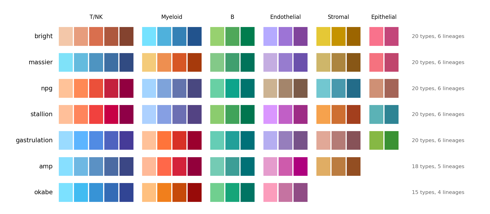

<details>
<summary><b>Measured separation of 20 cell-type colours</b></summary>

<br>

Measured on 20 cell types in 6 lineages (5/4/3/3/3/2), which gives 190 pairs of
colours. A pair counts as hard to tell apart below ΔE 10, or below 8 under
simulated red-green colour blindness.

| Palette | Hard pairs | Lowest ΔE between neighbouring shades | Hard pairs, colour-blind |
|---|---|---|---|
| `bright` | 2 | 10.2 | 22 |
| `stallion` | 2 | 11.8 | 24 |
| `gastrulation` | 3 | 11.3 | 14 |
| `massier` | 5 | 11.1 | 23 |
| `npg` | 12 | 11.6 | 29 |
| `amp` (18 types, 5 lineages, 153 pairs) | 4 | 11.1 | 16 |
| `okabe` (15 types, 4 lineages, 105 pairs) | 0 | 11.2 | 6 |
| For comparison: ArchR stallion, 20 colours | 6 | – | 21 |
| For comparison: scanpy default, 20 colours | 12 | – | 32 |

- Every style except `npg` has fewer hard pairs than the two reference
  palettes.
- Lowest ΔE between neighbouring shades by lineage size: 14 for 2 or 3 cell
  types, 12 to 15 for 4, 9 to 12 for 5, 7 to 9 for 6, 5 to 7 for 8.
- ΔE understates the gain from the hue shift, so judge a palette on a rendered
  UMAP as well. The UMAP figures here use synthetic points.

</details>

## What Claude decides for you

You do not choose the test. Claude derives it from two things you say: the kind
of data and the design. These tables show what it will pick, so you can check
its choice.

### From the kind of data

| You measured | Tested on | Test family | Drawn as |
|---|---|---|---|
| RNA expression (bulk or pseudobulk), log2 values | As given | Parametric | Bar |
| Protein intensity from proteomics, log2 values | As given | Parametric | Dot |
| qPCR fold change (2^-ΔΔCt) | log2 | Parametric | Bar |
| Western blot band intensity | log2 | Parametric | Bar |
| Concentration: ELISA, cytokines, metabolites | log2 | Parametric | Bar |
| Proportion: percent of cells or area | As given | Rank-based | Bar |
| Score: histology or clinical | As given | Rank-based | Dot |

- **Ratios and concentrations are tested on a log scale.** Their effects are
  multiplicative: a 2-fold increase and a 2-fold decrease should count the
  same. The figure still shows the original values.
- **A bar starts at zero only when zero means something.** Zero on a
  log-intensity axis does not, and a bar would exaggerate the difference, so
  protein data are drawn as dots.

### From the design

| Groups | Design | Parametric | Rank-based |
|---|---|---|---|
| 2 | Unpaired | Welch's t-test | Mann-Whitney |
| 2 | Paired | Paired t-test | Wilcoxon signed-rank |
| 3 or more | Every pair | One-way ANOVA, then Tukey | Kruskal-Wallis, then Dunn |
| 3 or more | Each group against a control | One-way ANOVA, then Dunnett | Kruskal-Wallis, then Dunn against the control |
| 3 or more | Unequal variances | Welch's ANOVA, then Games-Howell | – |
| 3 or more | Paired or repeated | Paired t-tests, Holm-adjusted | Friedman, then Wilcoxon, Holm-adjusted |

> [!TIP]
> Decide between "every pair" and "each against the control" before you look at
> the data, and say which you want. If the question is whether each treatment
> differs from the control, Dunnett's test is the right one and has more power
> than Tukey's.

> [!WARNING]
> With three values per group, an exact Mann-Whitney test cannot give a P value
> below 0.10. Claude warns you when a rank test cannot reach significance. A
> parametric test on a suitable scale is usually the better choice for small
> groups.

If your data were already modelled with limma, DESeq2 or a mixed model, give
Claude those P values and ask it to plot them. The model that knows the full
design wins over a second test on the plotted values. The same goes for
two-factor designs such as genotype × treatment.

### On the figure

- **The centre and the error bar match the test**: mean ± SEM for parametric
  tests, median with interquartile range for rank-based tests.
- **Every replicate is a point**, with the error bar drawn on top.
- **Up to three comparisons are all shown**, including non-significant ones.
  With more than three, only adjusted P < 0.05 is shown, and the methods
  sentence says so.
- **P values are exact** (`P = 0.0123`). Ask for asterisks if a journal wants
  them.

The full decision rules are in [SKILL.md](SKILL.md).

## Examples

Each figure is shown with a request that would produce it and what Claude
chose. The first four use the `bright` style.

| | |
|---|---|
| 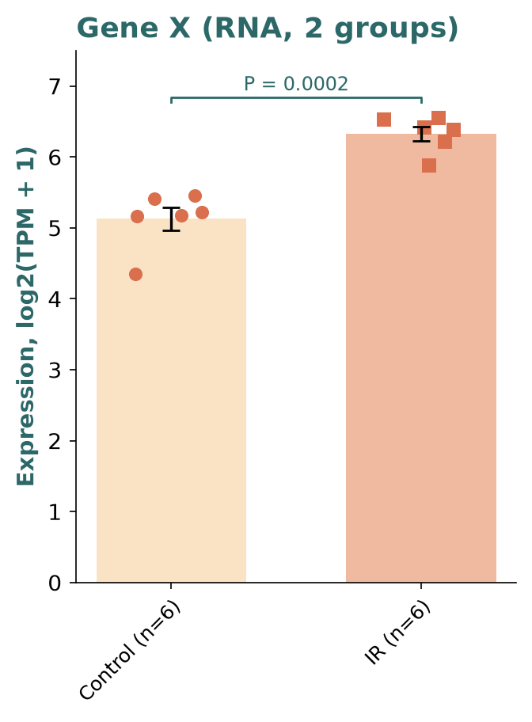 | 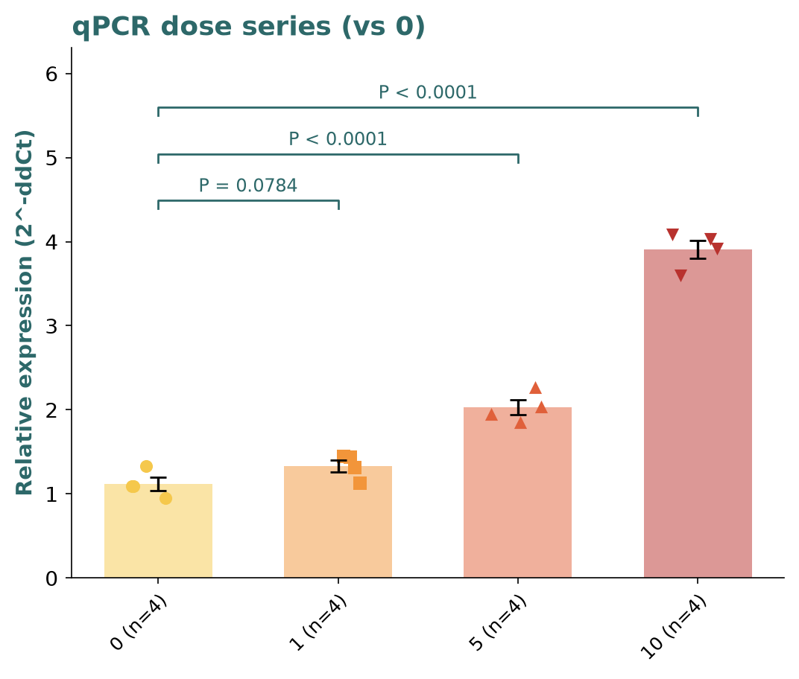 |
| **Asked:** "Compare gene X between the two groups, RNA-seq log2 values." · "比较两组的基因 X，RNA-seq 的 log2 值。"<br>**Chosen:** Welch's t-test, bars with mean ± SEM | **Asked:** "qPCR fold changes for a dose series. Compare each dose with the control." · "qPCR 的剂量序列，每个剂量都和对照比。"<br>**Chosen:** Dunnett's test on a log2 scale, the warm dose ramp |
| 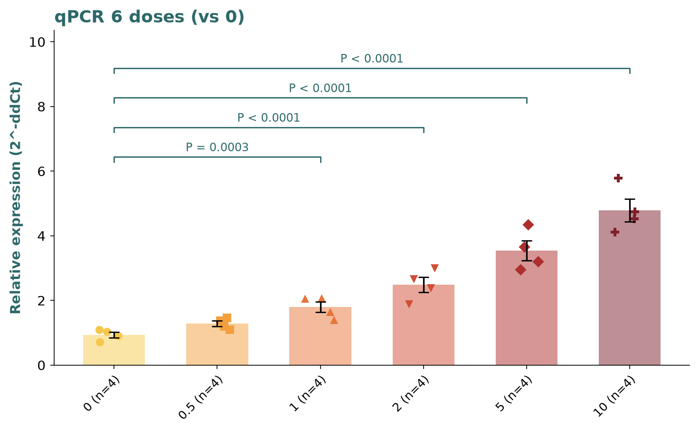 |  |
| **Asked:** "Six increasing doses, each against dose 0." · "六个递增的剂量，都和 0 剂量比。"<br>**Chosen:** Dunnett's test, the ramp from yellow to wine red, stacked brackets | **Asked:** "Compare every pair of these six groups." · "这六组两两比较。"<br>**Chosen:** All pairs tested, only the significant ones drawn; one hue and one marker shape per group |

A UMAP with its legend, for 20 cell types in six lineages in the `massier`
style. The legend is grouped by lineage and lists the hex code of every cell
type, so the same colours can be reused in other tools.

**Asked:** "Colour the 20 cell types by lineage in the massier style and list
the hex codes." · "用 massier 风格按大类给 20 个细胞类型配色，并列出色号。"

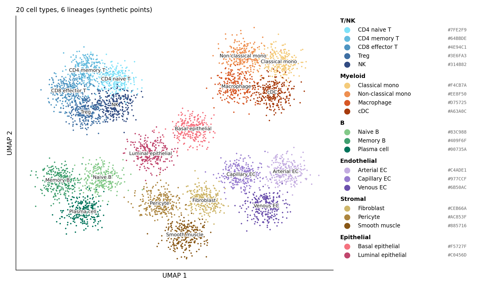

The points in this figure are synthetic.

## When not to use it

- **A continuous x-axis**, such as a dose-response curve or a time course with
  many points. Ask for a line plot or a fitted curve.
- **More than about eight groups in one plot.** A box plot, a violin plot or a
  heatmap reads better. The cell-type colours still apply.
- **Differential expression across thousands of genes.** Use limma or DESeq2,
  then plot selected genes here with the P values from that model.

## For Python users

The skill is plain Python underneath, and you can call it without Claude.

<details>
<summary><b>Calling the functions directly</b></summary>

<br>

Copy `kernel.py` next to your script as `prism_statplot.py`. It needs `numpy`,
`matplotlib` and `scipy` 1.11 or later.

```python
from prism_statplot import (compare_groups, group_style, prism_group_plot,
                            set_theme, celltype_palette)

set_theme("massier")                                        # the colour style

values = {"Ctrl": [...], "IR": [...], "IR+drug": [...]}     # one value per biological replicate
order = ["Ctrl", "IR", "IR+drug"]

res = compare_groups(values, order, data_type="qpcr", comparisons="vs_control")
fig, ax = prism_group_plot(values, order,
                           style=group_style(order, control="Ctrl"),
                           brackets=res["brackets"], ylabel=res["ylabel"],
                           mode=res["mode"], summary=res["summary"],
                           save_path="gene_x.pdf")
print(res["method"], res["warnings"])
```

Cell-type colours from two annotation columns:

```python
pairs = (adata.obs[["cell_type_coarse", "cell_type_fine"]]
         .drop_duplicates()
         .sort_values(["cell_type_coarse", "cell_type_fine"]))
lineages = dict(zip(pairs["cell_type_fine"], pairs["cell_type_coarse"]))

fine_palette = celltype_palette(list(lineages), lineages)                   # shades
coarse_palette = celltype_palette(list(dict.fromkeys(lineages.values())))   # hues

sc.pl.umap(adata, color="cell_type_fine", palette=fine_palette)
```

| Function | What it does |
|---|---|
| `set_theme(name)` | Chooses the colour style for every later plot |
| `compare_groups(values, order, ...)` | Picks and runs the test; returns brackets, summary type, methods sentence and warnings |
| `group_style(order, ...)` | Colours and marker shapes for one plot: `control`, `ordered`, `families`, `binding`, `theme` |
| `prism_group_plot(values, order, ...)` | Draws the figure |
| `celltype_palette(celltypes, lineages)` | One colour per cell type, as a dictionary. Leave out `lineages` for the coarse level |

Every function has a docstring with the full list of arguments.

</details>

## Where the colours come from

Only hex codes were taken from these files. Each code was copied from the file
itself.

| Style | File | Licence of the repository |
|---|---|---|
| `massier` | [lmassier/hWAT_singlecell](https://github.com/lmassier/hWAT_singlecell), `scripts/Cell_Types/*.R` | None stated |
| `npg` | [nanxstats/ggsci](https://github.com/nanxstats/ggsci), `R/palettes.R` | GPL-3.0 |
| `stallion` | [GreenleafLab/ArchR](https://github.com/GreenleafLab/ArchR), `R/ColorPalettes.R`; use in [saezlab/visium_heart](https://github.com/saezlab/visium_heart), `plot_figures/fig1.ipynb` | MIT; GPL-3.0 |
| `okabe` | [Swarbricklab-code/BrCa_cell_atlas](https://github.com/Swarbricklab-code/BrCa_cell_atlas), `figures_code/overview_figures_metrics.R` | None stated |
| `gastrulation` | [MarioniLab/EmbryoTimecourse2018](https://github.com/MarioniLab/EmbryoTimecourse2018), `analysis_scripts/atlas/core_functions.R` | None stated |
| `amp` | [immunogenomics/amp_phase1_ra](https://github.com/immunogenomics/amp_phase1_ra), `R/meta_colors.R` | GPL-3.0 |

<details>
<summary><b>Changes made to the source colours</b></summary>

<br>

- `massier`: the yellow end of the orange ramp is softened (`#F7E08A` in place
  of `#F3E55C`). Brown and wine red are additions.
- `npg`, `stallion`, `gastrulation`: a subset of the source palette, with light
  colours deepened for points.
- `okabe`: four of the eight colours. Yellow, grey, orange and sky blue are left
  out because they are too light for points or too close to another hue once
  deepened.
- `amp`: the blue point colour is the midpoint of the paper's two darker blues.
- Cell-type shades shift the hue within a lineage, so they are derived from the
  style's colours and are not the source colours themselves.

</details>

No palette from a paper in *Cell* is included. The candidates checked had no
explicit colour list in their public code.
