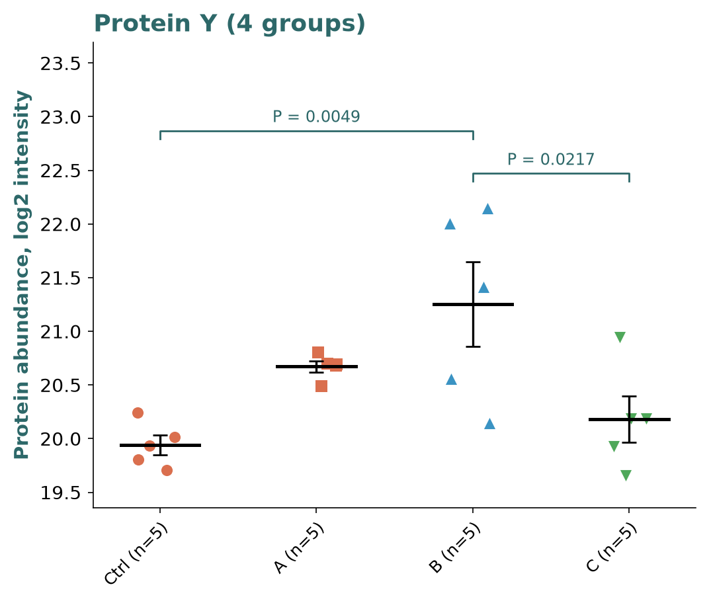
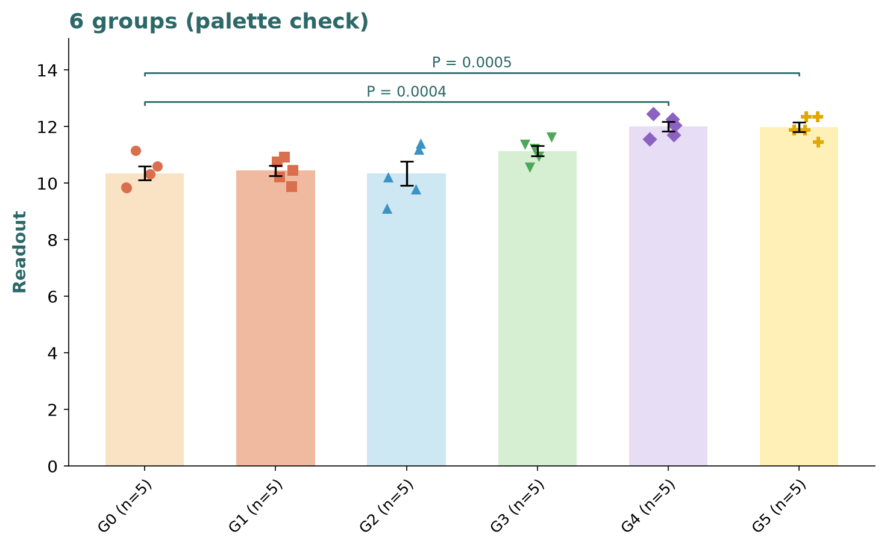

# prism-statplot

Prism-style group comparison plots for Python/matplotlib, with the statistical
test chosen from the data type and the experimental design.

GraphPad Prism 风格的组间比较图（柱/点 + 误差线 + 每个重复一个点 + 显著性括号），
统计方法根据数据类型和实验设计自动选择。


## What it does / 做什么

| Step | Function | |
|---|---|---|
| 1 | `compare_groups()` | picks the test from the design, runs it with the matching multiple-comparison correction, returns adjusted P values, brackets, and a ready-to-paste methods sentence |
| 2 | `group_style()` | fixed per-group colours and marker shapes (control / ordered dose-time series / externally bound colours) |
| 3 | `prism_group_plot()` | draws bar or dot + error bar + jittered replicates + stacked P-value brackets |

**Statistics** — 2 groups: Welch's t-test / Mann-Whitney / paired t / Wilcoxon.
3+ groups: ANOVA + Tukey (all pairs) or Dunnett (vs control), Welch's ANOVA + Games-Howell
(unequal variances), Kruskal-Wallis + Dunn, Friedman + Wilcoxon. Warnings for small n,
rank tests that cannot reach significance, and cells-as-replicates.

**Data types** — `rna`, `protein`, `qpcr`, `western`, `concentration`, `proportion`,
`score`, `generic`. Each sets the test scale (e.g. automatic log2 for qPCR / ELISA),
the default test family, and whether a bar from zero is meaningful
(protein log-intensity is drawn as dots, not bars).

**Style** — bright pastel bars with saturated points, no outlines; multi-hue
yellow → red ramp for dose / time series; one marker shape per group; teal
accent for brackets and P values.

Full decision rules: [SKILL.md](SKILL.md).

## Usage

```python
# copy kernel.py next to your script as prism_statplot.py
from prism_statplot import compare_groups, group_style, prism_group_plot

values = {"Ctrl": [...], "IR": [...], "IR+drug": [...]}   # one value per biological replicate
order = ["Ctrl", "IR", "IR+drug"]

res = compare_groups(values, order, data_type="rna", comparisons="vs_control")
fig, ax = prism_group_plot(values, order, style=group_style(order, control="Ctrl"),
                           brackets=res["brackets"], ylabel=res["ylabel"],
                           mode=res["mode"], summary=res["summary"],
                           save_path="gene_x.pdf")
print(res["method"])     # methods / legend sentence
print(res["warnings"])
```

Requires `numpy`, `scipy >= 1.11` (for `dunnett`), `matplotlib`.

## As a Claude Science skill

`SKILL.md` + `kernel.py` form a skill: import this repository as a skill and the
functions load automatically.

## Examples

| | |
|---|---|
|  |  |
| RNA, 2 groups, Welch's t-test | Protein (log2 intensity), 4 groups, Tukey, dot plot |
|  |  |
| qPCR dose series, Dunnett vs control on log2 scale | 6 groups, palette and marker shapes |
